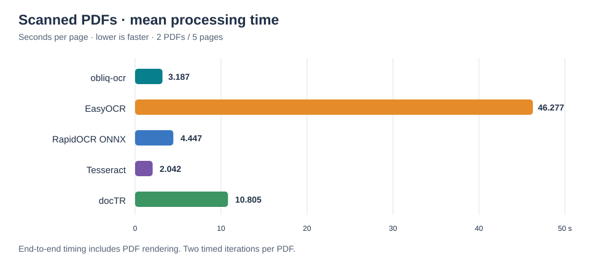
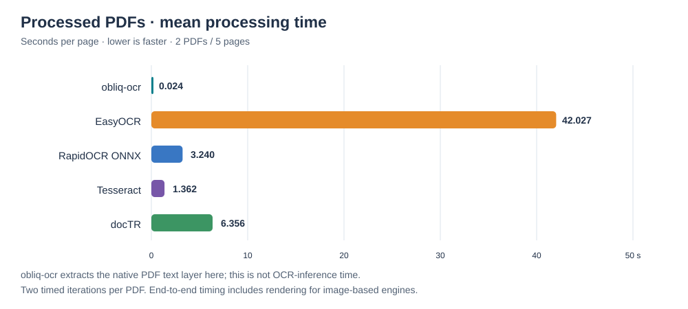
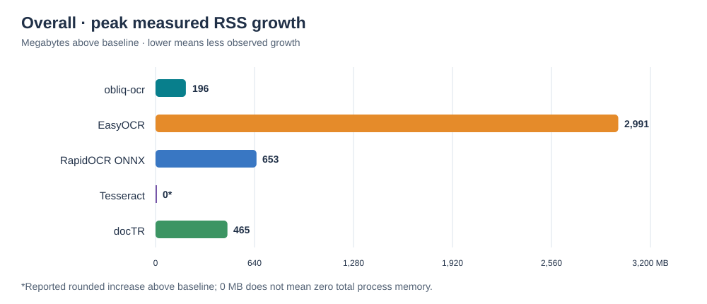
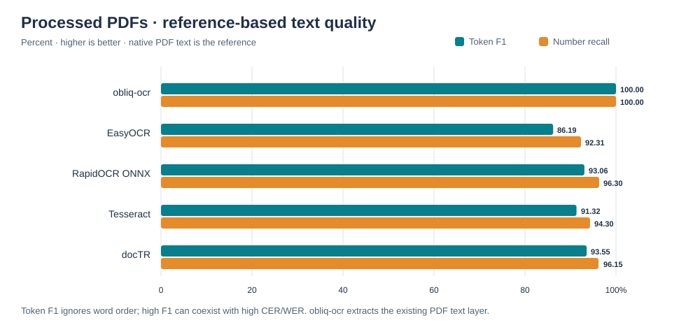

# obliq-OCR Benchmark Report

**CPU-only comparison across scanned and digitally processed PDFs**

[Benchmark dataset on Kaggle](https://www.kaggle.com/datasets/rahulkate173/obliq-ocr-benchmarking-dataset)

---

## Executive summary

This report presents the supplied benchmark run for **obliq-ocr**, **EasyOCR**, **RapidOCR ONNX**, **Tesseract**, and **docTR**.

- **Scanned PDFs:** Tesseract had the lowest mean page time at **2.042 seconds/page**. obliq-ocr averaged **3.187 seconds/page** and used **196 MB** of peak measured RSS growth.
- **Processed PDFs:** obliq-ocr averaged **0.024 seconds/page** by reading the PDF's existing text layer. This is a text-extraction path, not OCR inference, so it is not a like-for-like OCR speed comparison.
- **Processed-PDF quality:** obliq-ocr reported **100% token F1** and **100% number recall** against the available text-layer reference. CER and WER were still **67.66%** and **75.54%**, respectively; the high token overlap does not imply an identical character or word sequence.
- **Scope:** Four PDFs, ten pages, five engines, and two timed iterations per PDF and engine. No reference text was available for the scanned PDFs.

These are results from a small sample in one environment. They should be treated as indicative, not as a general performance guarantee.

## Benchmark setup

| Item | Details |
|---|---|
| Execution | CPU-only |
| Timed iterations | 2 per PDF and engine |
| Compared engines | obliq-ocr, EasyOCR, RapidOCR ONNX, Tesseract, docTR |
| Scanned input | `scanned1.pdf` (3 pages), `scanned2.pdf` (2 pages) |
| Processed input | `processed1.pdf` (1 page), `processed2.pdf` (4 pages) |
| Ground truth | None for scanned PDFs; native PDF text layer for processed PDFs |
| Python version, CPU count, and rendering DPI | Not shown in the supplied results |

### How to read the metrics

| Metric | Meaning | Preferred direction |
|---|---|---|
| Cold start | Import, model setup, and warm-up | Lower |
| Mean latency / doc; P95 latency | End-to-end time from PDF input to extracted text | Lower |
| Latency jitter | Standard deviation of per-document time across iterations | Lower |
| Seconds / page; throughput | Time normalized by pages; pages processed per second | Lower time; higher throughput |
| Peak memory | Peak measured increase in process RSS while processing | Lower; this is growth, not total memory |
| Confidence | Engine-reported mean confidence | Informational only; engine scales differ |
| CER; WER | Character and word error rates versus reference | Lower |
| Token F1; number recall | Bag-of-words overlap and numeric-string recall versus reference | Higher |
| Consensus agreement | Token overlap with other OCR engines | Higher agreement, not necessarily higher accuracy |
| Garbage ratio | Share of junk or replacement characters | Lower |
| Run-to-run stability | Similarity of output between timed iterations | Higher |

The benchmark uses a supplied ground-truth text file when present and otherwise uses a processed PDF's native text layer. Without a reference, reference-based quality metrics are unavailable, but OCR-engine consensus can still be calculated.

## Metric charts

Charts below are vector graphics available as standalone files. Exact values are provided in the summary tables.

### Scanned PDFs — mean processing time per page

### Processed PDFs — mean processing time per page

> obliq-ocr uses the native PDF text layer for these inputs; its processing time is not OCR inference time.

### Overall — peak measured RSS growth

### Processed PDFs — text quality

## Summary results

Values below are transcribed from the supplied benchmark output. The benchmark's asterisk denotes its selected best value; use metric direction when interpreting results, especially for error rates. Confidence is shown as reported and is not directly comparable across engines.

> **Why `n/a` appears:** For scanned PDFs, no ground-truth text was available, so CER, WER, token F1, and number recall could not be calculated for any engine. For obliq-ocr on processed PDFs, `n/a` confidence means the native-text extraction path does not produce an OCR confidence score; it does not mean confidence was measured as zero. The same applies to the per-page confidence values for processed PDFs.

### Scanned PDFs

| Metric | obliq-ocr | EasyOCR | RapidOCR ONNX | Tesseract | docTR |
|---|---:|---:|---:|---:|---:|
| Cold start (s) | 1.10 | 18.30 | 0.92* | 1.22 | 18.33 |
| Mean latency / doc (s) | 7.97 | 115.69 | 11.12 | 5.11* | 27.01 |
| P95 latency (s) | 9.86 | 140.49 | 13.49 | 6.89* | 31.86 |
| Latency jitter σ (s) | 0.053 | 0.542 | 0.534 | 0.034* | 0.057 |
| Seconds / page | 3.187 | 46.277 | 4.447 | 2.042* | 10.805 |
| Throughput (pages/s) | 0.31 | 0.02 | 0.22 | 0.49* | 0.09 |
| Peak memory (MB) | 196 | 2,991 | 642 | 0* | 465 |
| Mean confidence (informational) | 0.682 | 0.180 | 0.677 | 0.446 | 0.647 |
| CER (%) | n/a | n/a | n/a | n/a | n/a |
| WER (%) | n/a | n/a | n/a | n/a | n/a |
| Token F1 (%) | n/a | n/a | n/a | n/a | n/a |
| Number recall (%) | n/a | n/a | n/a | n/a | n/a |
| Consensus agreement (%) | 23.78%* | 10.96% | 21.77% | 20.52% | 21.87% |
| Garbage ratio (%) | 0.00%* | 0.00% | 0.00% | 0.46% | 0.00% |
| Run-to-run stability (%) | 100.00%* | 100.00% | 100.00% | 100.00% | 100.00% |
| Documents completed | 2/2 | 2/2 | 2/2 | 2/2 | 2/2 |
| Mean rank (lower is better) | 1.70 | 4.30 | 3.00 | 2.20 | 3.80 |

### Processed PDFs

| Metric | obliq-ocr | EasyOCR | RapidOCR ONNX | Tesseract | docTR |
|---|---:|---:|---:|---:|---:|
| Cold start (s) | 1.10 | 18.30 | 0.92* | 1.22 | 18.33 |
| Mean latency / doc (s) | 0.06* | 105.07 | 8.10 | 3.40 | 15.89 |
| P95 latency (s) | 0.11* | 165.96 | 12.78 | 5.42 | 24.70 |
| Latency jitter σ (s) | 0.002* | 0.792 | 0.120 | 0.049 | 0.152 |
| Seconds / page | 0.024* | 42.027 | 3.240 | 1.362 | 6.356 |
| Throughput (pages/s) | 42.40* | 0.02 | 0.31 | 0.73 | 0.16 |
| Peak memory (MB) | 0 | 2,931 | 653 | 0* | 338 |
| Mean confidence (informational) | n/a | 0.843 | 0.847 | 0.913 | 0.922 |
| CER (%) | 67.66%* | 70.73% | 69.70% | 67.92% | 70.22% |
| WER (%) | 75.54% | 85.98% | 79.62% | 75.53%* | 80.56% |
| Token F1 (%) | 100.00%* | 86.19% | 93.06% | 91.32% | 93.55% |
| Number recall (%) | 100.00%* | 92.31% | 96.30% | 94.30% | 96.15% |
| Consensus agreement (%) | 91.03% | 86.12% | 90.53% | 89.69% | 91.48%* |
| Garbage ratio (%) | 0.00%* | 0.00% | 0.00% | 0.00% | 0.00% |
| Run-to-run stability (%) | 100.00%* | 100.00% | 100.00% | 100.00% | 100.00% |
| Documents completed | 2/2 | 2/2 | 2/2 | 2/2 | 2/2 |
| Mean rank (lower is better) | 1.29 | 4.50 | 2.86 | 2.64 | 3.71 |

### Overall

| Metric | obliq-ocr | EasyOCR | RapidOCR ONNX | Tesseract | docTR |
|---|---:|---:|---:|---:|---:|
| Cold start (s) | 1.10 | 18.30 | 0.92* | 1.22 | 18.33 |
| Mean latency / doc (s) | 4.01* | 110.38 | 9.61 | 4.26 | 21.45 |
| P95 latency (s) | 9.83 | 165.84 | 13.45 | 6.86* | 31.82 |
| Latency jitter σ (s) | 0.028* | 0.667 | 0.327 | 0.042 | 0.105 |
| Seconds / page | 1.605* | 44.152 | 3.844 | 1.702 | 8.580 |
| Throughput (pages/s) | 0.62* | 0.02 | 0.26 | 0.59 | 0.12 |
| Peak memory (MB) | 196 | 2,991 | 653 | 0* | 465 |
| Mean confidence (informational) | 0.682 | 0.511 | 0.762 | 0.680 | 0.785 |
| CER (%) | 67.66%* | 70.73% | 69.70% | 67.92% | 70.22% |
| WER (%) | 75.54% | 85.98% | 79.62% | 75.53%* | 80.56% |
| Token F1 (%) | 100.00%* | 86.19% | 93.06% | 91.32% | 93.55% |
| Number recall (%) | 100.00%* | 92.31% | 96.30% | 94.30% | 96.15% |
| Consensus agreement (%) | 57.41%* | 48.54% | 56.15% | 55.11% | 56.68% |
| Garbage ratio (%) | 0.00%* | 0.00% | 0.00% | 0.23% | 0.00% |
| Run-to-run stability (%) | 100.00%* | 100.00% | 100.00% | 100.00% | 100.00% |
| Documents completed | 4/4 | 4/4 | 4/4 | 4/4 | 4/4 |
| Mean rank (lower is better) | 1.29 | 4.50 | 2.93 | 2.64 | 3.64 |

## Per-iteration results

Each row is one timed pass over the whole PDF. `+MB` is measured peak RSS growth for that pass. The console output rounded total duration to two decimals and seconds per page to three decimals.

### Scanned PDFs

| PDF | Engine | Iteration | Time (s) | Pages | s/page | Characters | Confidence | +MB |
|---|---|---:|---:|---:|---:|---:|---:|---:|
| scanned1.pdf | obliq-ocr | 1 | 9.88 | 3 | 3.295 | 2,444 | 0.711 | 180 |
| scanned1.pdf | obliq-ocr | 2 | 9.73 | 3 | 3.243 | 2,444 | 0.711 | 196 |
| scanned1.pdf | EasyOCR | 1 | 140.77 | 3 | 46.923 | 2,417 | 0.220 | 2,991 |
| scanned1.pdf | EasyOCR | 2 | 138.91 | 3 | 46.304 | 2,417 | 0.220 | 2,912 |
| scanned1.pdf | RapidOCR ONNX | 1 | 13.80 | 3 | 4.600 | 2,618 | 0.720 | 582 |
| scanned1.pdf | RapidOCR ONNX | 2 | 11.70 | 3 | 3.901 | 2,618 | 0.720 | 642 |
| scanned1.pdf | Tesseract | 1 | 6.91 | 3 | 2.304 | 3,342 | 0.424 | 0 |
| scanned1.pdf | Tesseract | 2 | 6.78 | 3 | 2.259 | 3,342 | 0.424 | 0 |
| scanned1.pdf | docTR | 1 | 31.88 | 3 | 10.627 | 3,782 | 0.677 | 465 |
| scanned1.pdf | docTR | 2 | 31.72 | 3 | 10.573 | 3,782 | 0.677 | 420 |
| scanned2.pdf | obliq-ocr | 1 | 6.16 | 2 | 3.079 | 1,186 | 0.652 | 137 |
| scanned2.pdf | obliq-ocr | 2 | 6.10 | 2 | 3.051 | 1,186 | 0.652 | 137 |
| scanned2.pdf | EasyOCR | 1 | 91.70 | 2 | 45.851 | 1,318 | 0.140 | 2,933 |
| scanned2.pdf | EasyOCR | 2 | 91.39 | 2 | 45.696 | 1,318 | 0.140 | 2,930 |
| scanned2.pdf | RapidOCR ONNX | 1 | 9.50 | 2 | 4.752 | 1,015 | 0.633 | 642 |
| scanned2.pdf | RapidOCR ONNX | 2 | 9.47 | 2 | 4.733 | 1,015 | 0.633 | 642 |
| scanned2.pdf | Tesseract | 1 | 3.37 | 2 | 1.684 | 1,284 | 0.468 | 0 |
| scanned2.pdf | Tesseract | 2 | 3.37 | 2 | 1.683 | 1,284 | 0.468 | 0 |
| scanned2.pdf | docTR | 1 | 22.19 | 2 | 11.095 | 2,325 | 0.618 | 405 |
| scanned2.pdf | docTR | 2 | 22.26 | 2 | 11.129 | 2,325 | 0.618 | 406 |

### Processed PDFs

| PDF | Engine | Iteration | Time (s) | Pages | s/page | Characters | Confidence | +MB |
|---|---|---:|---:|---:|---:|---:|---:|---:|
| processed1.pdf | obliq-ocr | 1 | 0.01 | 1 | 0.012 | 675 | n/a | 0 |
| processed1.pdf | obliq-ocr | 2 | 0.01 | 1 | 0.010 | 675 | n/a | 0 |
| processed1.pdf | EasyOCR | 1 | 45.66 | 1 | 45.659 | 684 | 0.841 | 2,928 |
| processed1.pdf | EasyOCR | 2 | 43.12 | 1 | 43.118 | 684 | 0.841 | 2,884 |
| processed1.pdf | RapidOCR ONNX | 1 | 3.23 | 1 | 3.228 | 685 | 0.835 | 642 |
| processed1.pdf | RapidOCR ONNX | 2 | 3.65 | 1 | 3.647 | 685 | 0.835 | 642 |
| processed1.pdf | Tesseract | 1 | 1.44 | 1 | 1.437 | 677 | 0.897 | 0 |
| processed1.pdf | Tesseract | 2 | 1.46 | 1 | 1.462 | 677 | 0.897 | 0 |
| processed1.pdf | docTR | 1 | 7.33 | 1 | 7.328 | 685 | 0.935 | 336 |
| processed1.pdf | docTR | 2 | 7.12 | 1 | 7.122 | 685 | 0.935 | 338 |
| processed2.pdf | obliq-ocr | 1 | 0.11 | 4 | 0.028 | 2,375 | n/a | 0 |
| processed2.pdf | obliq-ocr | 2 | 0.10 | 4 | 0.026 | 2,375 | n/a | 0 |
| processed2.pdf | EasyOCR | 1 | 165.43 | 4 | 41.358 | 2,272 | 0.845 | 2,886 |
| processed2.pdf | EasyOCR | 2 | 166.06 | 4 | 41.515 | 2,272 | 0.845 | 2,931 |
| processed2.pdf | RapidOCR ONNX | 1 | 12.73 | 4 | 3.183 | 2,299 | 0.858 | 653 |
| processed2.pdf | RapidOCR ONNX | 2 | 12.79 | 4 | 3.197 | 2,299 | 0.858 | 597 |
| processed2.pdf | Tesseract | 1 | 5.27 | 4 | 1.319 | 2,294 | 0.929 | 0 |
| processed2.pdf | Tesseract | 2 | 5.45 | 4 | 1.361 | 2,294 | 0.929 | 0 |
| processed2.pdf | docTR | 1 | 24.35 | 4 | 6.088 | 2,322 | 0.909 | 265 |
| processed2.pdf | docTR | 2 | 24.76 | 4 | 6.189 | 2,322 | 0.909 | 314 |

## obliq-ocr page-level timings

| PDF | Page | Processing path | Time run 1 (ms) | Time run 2 (ms) | Existing text-layer characters | Confidence | Notes |
|---|---:|---|---:|---:|---:|---:|---|
| scanned1.pdf | 1 | OCR | 2,100.7 | 2,000.7 | 0 | 0.81 | |
| scanned1.pdf | 2 | OCR | 3,816.8 | 4,260.5 | 0 | 0.71 | |
| scanned1.pdf | 3 | OCR | 3,857.1 | 3,463.6 | 0 | 0.62 | |
| scanned2.pdf | 1 | OCR | 3,339.4 | 3,375.1 | 0 | 0.65 | |
| scanned2.pdf | 2 | OCR | 2,735.3 | 2,723.2 | 0 | 0.65 | |
| processed1.pdf | 1 | Text layer | 8.5 | 6.9 | 567 | n/a | Image cover: 1% |
| processed2.pdf | 1 | Text layer | 28.2 | 25.8 | 511 | n/a | Image cover: 7% |
| processed2.pdf | 2 | Text layer | 25.7 | 22.9 | 511 | n/a | Image cover: 7% |
| processed2.pdf | 3 | Text layer | 26.4 | 23.7 | 511 | n/a | Image cover: 7% |
| processed2.pdf | 4 | Text layer | 23.3 | 23.6 | 511 | n/a | Image cover: 7% |

## Findings and limitations

- Tesseract was the fastest engine for scanned PDFs in this run at **2.042 seconds/page**.
- The overall table shows obliq-ocr at **1.605 seconds/page**, but this combines scanned OCR pages with processed pages handled through native text extraction. It should not be interpreted as the fastest OCR engine overall.
- Reference-based metrics for scanned documents are unavailable because no ground truth was supplied for those files.
- The processed PDFs have a native text layer, which is used as the reference. Token F1 is order-insensitive, while CER and WER are sequence-sensitive; high token F1 can coexist with high sequence error rates.
- The reported **100% run-to-run stability** means the two runs produced matching normalized text for each engine/document in this run. Two iterations are too few to establish general reliability or performance variance.
- A reported **0 MB memory growth** is the measured/rounded increase above baseline, not a claim that the process used no memory.
- Engine confidence scores use engine-specific scales and should not be ranked against one another.

---

**Dataset:** [https://www.kaggle.com/datasets/rahulkate173/obliq-ocr-benchmarking-dataset](https://www.kaggle.com/datasets/rahulkate173/obliq-ocr-benchmarking-dataset)
