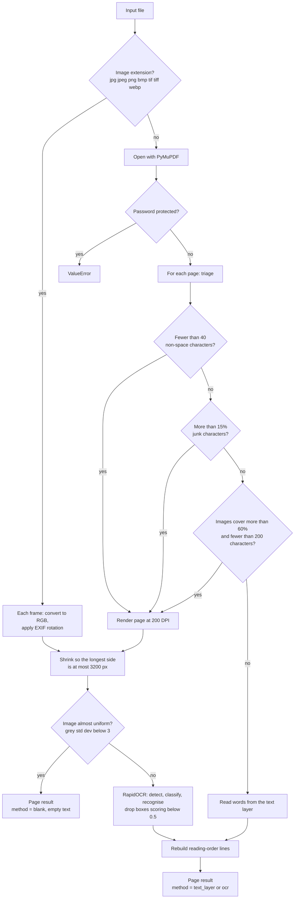

# Architecture and output schema

This page explains how obliq-ocr decides what to do with each page, what it
returns, and how errors show up. It describes the code as it is in
`src/obliq_ocr/`; if the two disagree, the code wins and this page needs a fix.

## The idea in one paragraph

Tax documents arrive as a mix of digital PDFs, scanned PDFs, and photos. OCR is
slow (seconds per page) and can misread text, while a PDF's own text layer is
fast (milliseconds) and exact. So obliq-ocr looks at **every page on its own**:
if the page already has good digital text, it reads that text directly with
PyMuPDF; if not, it renders the page to an image and reads it with RapidOCR. A
PDF where page 1 is digital and page 2 is a scan is handled correctly without
any setting.

## How a page is routed



### Triage rules

`triage_page()` in `parser.py` decides between the text layer and OCR. The
checks run in this order and the first one that matches sends the page to OCR:

| Check | Default | Reason written to the output |
|---|---|---|
| Fewer non-space characters than `MIN_TEXT_CHARS` | 40 | `only 3 text chars` |
| Share of junk characters above `GARBAGE_MAX` | 0.15 | `garbled text layer (20% junk)` |
| Images cover more than `IMG_COVER_MAX` of the page **and** fewer than `IMG_MIN_CHARS` characters | 0.60, 200 | `full-page image + thin text (150 chars)` |
| None of the above: use the text layer | | `412 chars, image cover 0%` |

"Junk" (`garbage_ratio()` in `utils.py`) counts the Unicode replacement
character, control characters, private-use characters, and `(cid:…)` sequences
(each counted three times). These appear when a PDF's fonts don't map back to
real characters.

The blank check only runs on pages that go to OCR. A digital page with no text
at all fails the first check, is rendered, and then comes out as `blank` with
the reason `only 0 text chars, blank page`.

### Rebuilding the text

Both paths produce word or line boxes, which `words_to_lines()` in `utils.py`
turns back into text:

1. Boxes are sorted top to bottom, then left to right.
2. Boxes whose vertical centres are close (within 0.6 of the line height) are
   joined into one line.
3. Inside a line, a horizontal gap wider than one line height becomes ` | `,
   so table columns stay apart: `Invoice No | 12345 | ₹50,000`.

### Device and engine

RapidOCR runs on ONNX Runtime. The device is chosen in this order:

1. `force_device="cpu"` or `"cuda"` passed to `parse_document()` (or `--device`
   on the CLI).
2. The `OBLIQ_OCR_DEVICE` environment variable (`cpu` or `cuda`).
3. Automatic: CUDA if `onnxruntime-gpu` is installed and offers
   `CUDAExecutionProvider`, otherwise CPU.

Asking for CUDA when it isn't available raises `RuntimeError`. If CUDA is
available but the engine fails to start on it, obliq-ocr prints a message and
falls back to CPU. The engine is loaded once and reused for later calls in the
same process, as long as the device stays the same.

The models are the PP-OCRv4 detection and recognition models and the PP-OCR
mobile v2.0 direction classifier that ship inside the `rapidocr_onnxruntime`
package. The model card (#48) lists their versions and measured accuracy.

## Output schema

`parse_document()` returns a `DocResult`. `DocResult.to_dict()` gives the shape
below, and `save_result()` writes exactly this as `<name>.json`. This example
is real output for the `mixed.pdf` test fixture (page 1 digital, page 2
scanned), with times rounded:

```json
{
  "source": "mixed.pdf",
  "device": "CPU",
  "pages": [
    {
      "page": 1,
      "method": "text_layer",
      "reason": "97 chars, image cover 0%",
      "text": "Mixed document digital page.\nThis page contains native text layer elements.\nIt should be extracted via text layer.",
      "n_chars": 114,
      "confidence": null,
      "seconds": 0.018
    },
    {
      "page": 2,
      "method": "ocr",
      "reason": "only 0 text chars",
      "text": "Mixed document scanned page.",
      "n_chars": 28,
      "confidence": 1.0,
      "seconds": 0.516
    }
  ]
}
```

### Document fields

| Field | Type | Meaning |
|---|---|---|
| `source` | string | File name of the input, without its folder |
| `device` | string | `"CPU"` or `"CUDA"`, the device OCR ran on |
| `pages` | list | One entry per page, in page order |

### Page fields

| Field | Type | Meaning |
|---|---|---|
| `page` | integer | Page number, starting at 1. For image files, the frame number. |
| `method` | string | `"text_layer"`, `"ocr"` or `"blank"` |
| `reason` | string | Why that method was chosen (see the triage table). Meant for people and logs, not for parsing. |
| `text` | string | The page text in reading order. Lines are separated by `\n`, wide gaps by ` \| `. Empty for blank pages. |
| `n_chars` | integer | Length of `text` |
| `confidence` | number or null | Mean RapidOCR score of the kept boxes, from 0 to 1. `null` for `text_layer` and `blank` pages, and for `ocr` pages where no text was found. |
| `seconds` | number | Time spent on this page |

### What confidence means

- It is the **average** score of the boxes RapidOCR kept on the page. A page
  can have a good average and still contain one badly read amount.
- Boxes scoring below 0.5 (`OCR_MIN_SCORE` in `engine.py`) are dropped before
  the average is taken, so faint or unreadable text disappears from `text`
  rather than showing up as a low score.
- `null` never means "zero". For `text_layer` pages the text comes straight
  from the PDF, so there is nothing to score.

### The text file

`save_result()` also writes `<name>.txt`: every page's text under a header
line such as `===== PAGE 2 [ocr] =====`. It is the same as
`DocResult.full_text()`.

### Coordinates are not in the output yet

The pipeline does compute a bounding box for every word (text layer) and every
OCR box, but `parse_document()` currently drops them, so the output above has
no coordinates. `schemas.py` defines richer types (`DocumentOutput`,
`PageOutput`, `TextElement` with `bbox`) that are exported from the package,
but nothing returns them yet. #71 tracks adding them.

When boxes are added, they will use `[x0, y0, x1, y1]` with the origin at the
top-left: PDF points (1/72 inch) for text-layer pages, and pixels of the
rendered image for OCR pages. OCR images are rendered at 200 DPI and then
shrunk if their longest side is over 3200 px, so pixel coordinates are only at
200 DPI when no shrinking happened.

## Failure modes

| Situation | What happens |
|---|---|
| File doesn't exist | `FileNotFoundError` before any work. The CLI prints `ERROR: …` and exits with code 1. |
| Password-protected PDF | `ValueError`. The CLI prints `ERROR: …` and exits with code 1. |
| Corrupt PDF, or a type that isn't PDF or a supported image (for example `.docx`) | `pymupdf.FileDataError` (a `RuntimeError`) from PyMuPDF. The CLI doesn't catch it, so it shows a traceback. |
| `force_device="cuda"` or `OBLIQ_OCR_DEVICE=cuda` without CUDA | `RuntimeError` |
| CUDA available but the engine fails to start on it | A message is printed and OCR runs on CPU |
| Page is empty or nearly uniform | `method: "blank"`, empty text, no error |
| OCR finds no text it trusts | `method: "ocr"`, empty text, `confidence: null`, no error |
| An error on one page | The whole call stops and earlier pages are lost. There is no per-page error status yet; #54 tracks adding one. |

There is no low-confidence flag in the output. Callers that need one should
compare `confidence` against their own threshold and treat `null` on an `ocr`
page as "nothing readable found".

## Tuning knobs

These are module-level constants. They are not a stable public API, and
changing them affects every call in the process.

| Constant | Module | Default | Effect |
|---|---|---|---|
| `OCR_DPI` | `parser` | 200 | Render resolution for OCR. 300 helps with tiny print but is slower. |
| `MIN_TEXT_CHARS` | `parser` | 40 | Below this, a page is treated as scanned |
| `GARBAGE_MAX` | `parser` | 0.15 | Junk share that sends a page to OCR |
| `IMG_COVER_MAX`, `IMG_MIN_CHARS` | `parser` | 0.60, 200 | Full-page image with little text goes to OCR |
| `OCR_MIN_SCORE` | `engine` | 0.5 | OCR boxes below this score are dropped |
| `MAX_SIDE_PX` | `utils` | 3200 | Longest side of an image sent to OCR |
| `COL_GAP_FACTOR` | `utils` | 1.0 | Gap, in line heights, that becomes ` \| ` |
