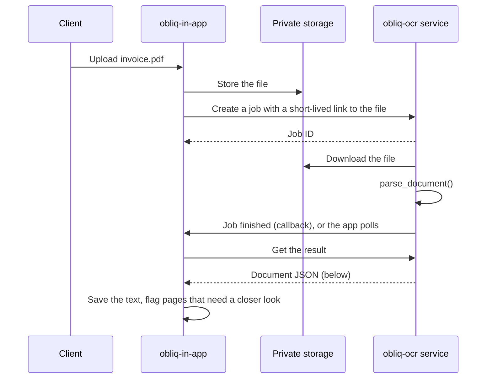

# Integration contract with obliq-in-app

> **Status: draft.** The output contract, error handling and confidence rules
> below describe what obliq-ocr does today. **How** the app calls obliq-ocr is
> still being decided in #52, so the call flow is a proposal. This page needs a
> review from an obliq-in-app maintainer before it's final.

This page is for anyone wiring [obliq-in-app](https://github.com/OBLIQ-in/obliq-in-app)
to obliq-ocr: what to send, what comes back, and what to do when a page can't
be read well.

## What obliq-ocr does and doesn't do

obliq-ocr turns a PDF or image into **page text**. It does not:

- find fields such as GSTIN, invoice number or amounts: that is a separate step
  on top of the page text, and nothing in either repository does it yet;
- return where on the page a value came from: coordinates are planned in #71;
- decide whether a value is correct: every value is a proposal for a reviewer.

## Call flow (proposed, pending #52)

The app is TypeScript on Netlify, and obliq-ocr is Python, so the app can't
import it. Three things rule out running obliq-ocr inside the app's own
functions:

- Netlify Functions run TypeScript, JavaScript or Go, not Python.
- A synchronous function stops after 60 seconds. OCR takes about 3–4 seconds
  per scanned page on a CPU (see `BENCHMARK.md`), so a 20-page scanned bundle
  needs well over a minute.
- Requests are limited to 6 MB (about 4.5 MB for base64 uploads), which a
  scanned PDF can easily exceed.

Limits are from Netlify's
[functions configuration docs](https://docs.netlify.com/build/functions/configuration/)
as of November 2026.

The proposal is to run obliq-ocr as its own small service in a container (#53
already plans the image) and use it **asynchronously**: the app hands over a
file, gets a job ID back straight away, and collects the result when it's
ready.



Everything below this point holds whichever option #52 picks: the service
only wraps `parse_document()` and sends its result as JSON.

## Output contract

The result is the JSON from `DocResult.to_dict()`, the same as the file
`save_result()` writes. The [architecture doc](architecture.md) explains
every field in detail. In TypeScript:

```ts
type OcrMethod = "text_layer" | "ocr" | "blank";

interface OcrPage {
  page: number;              // 1-based page (or image frame) number
  method: OcrMethod;
  reason: string;            // why that method was chosen; for logs, don't parse it
  text: string;              // reading order; lines split by "\n", wide gaps by " | "
  n_chars: number;           // length of text
  confidence: number | null; // 0 to 1, only for method "ocr"
  seconds: number;           // time spent on this page
}

interface OcrDocument {
  source: string;            // file name, without its folder
  device: "CPU" | "CUDA";
  pages: OcrPage[];          // one per page, in order
}
```

Example, a two-page PDF where page 2 is a scan:

```json
{
  "source": "invoice.pdf",
  "device": "CPU",
  "pages": [
    {"page": 1, "method": "text_layer", "reason": "97 chars, image cover 0%",
     "text": "Mixed document digital page.\n...", "n_chars": 114,
     "confidence": null, "seconds": 0.018},
    {"page": 2, "method": "ocr", "reason": "only 0 text chars",
     "text": "Mixed document scanned page.", "n_chars": 28,
     "confidence": 1.0, "seconds": 0.516}
  ]
}
```

Rules for the app:

- **Ignore fields you don't know.** New fields (page coordinates from #71,
  a per-page status from #54) will arrive in minor releases.
- **Don't parse `reason`.** Its wording can change in any release. Use
  `method` and `confidence` for decisions.
- **`confidence: null` is not zero.** It means the text came straight from the
  PDF (`text_layer`), the page was blank, or OCR found nothing it trusted.

## Low-confidence and failed pages

obliq-ocr has no "low confidence" flag; the app decides. Measurements in the
model card (#74) showed page confidence between 0.94 and 0.99 **even when an
amount was read wrong** (at 72 DPI, `1,03,750.00` came out as `1.03,750.00`).
So confidence can point to bad pages, but a high score proves nothing.

Suggested handling per page:

| Page | Show the reviewer |
|---|---|
| `method: "text_layer"` | Normal. The text came from the PDF itself. |
| `method: "ocr"`, `confidence` at or above the threshold | Normal, marked as scanned. Values still need checking. |
| `method: "ocr"`, `confidence` below the threshold | "Low confidence: check this page against the original". |
| `method: "ocr"`, empty `text` | "No readable text": ask the client for a clearer scan. |
| `method: "blank"` | "Blank page": often the back of a sheet, but worth a glance. |

Start the threshold at **0.85**, keep it a setting, and tune it on pilot
documents. The number is a starting guess, not a measured cut-off.

Whatever the confidence, check extracted values before they reach a working
paper:

- A GSTIN has 15 characters and a check digit: validate it.
- Line items, tax and total should add up.
- Scanned pages never contain `₹` or Hindi text: the OCR model can't produce
  them. Missing currency symbols are expected, not an error.
- Dots and commas in amounts can swap on poor scans.

## Errors

Today `parse_document()` raises an exception, and the whole document fails:
there is no partial result (#54 will add a per-page status). The service
should turn exceptions into a stable error code, so the app never has to read
Python messages:

| Exception today | Proposed `code` | What the app tells the client |
|---|---|---|
| `ValueError` (password-protected PDF) | `password_protected` | "This PDF is locked. Please upload it without a password." |
| `pymupdf.FileDataError` (corrupt file, or a type that isn't PDF or an image) | `unreadable_file` | "We couldn't open this file. Please upload a PDF, JPG or PNG." |
| `FileNotFoundError` | `internal` | Nothing to the client. Retry once, then alert staff: the file didn't reach the service. |
| Anything else | `internal` | Same as above. |

Proposed error body:

```json
{"error": {"code": "password_protected", "message": "The PDF is password-protected."}}
```

`message` is for logs. Don't show it to clients, and never put file paths or
document text in it.

## Versions

obliq-ocr follows [semantic versioning](VERSIONING_POLICY.md): removing or
renaming an output field is a **major** release; new fields come in minor
releases. Neither project has released yet.

| obliq-in-app | obliq-ocr | Output contract |
|---|---|---|
| v1 pilot (unreleased) | 0.1.x (unreleased, #39) | This page |

The app should pin a compatible range (`>=0.1,<1.0` for a library, or the
image tag for a service), and this table gets a row with every release that
changes the contract.

## Data handling

Tax documents are confidential. Until #55 sets the full policy:

- The app should send a short-lived link or the file itself, never a public
  URL.
- The service should delete the file and the text once the job is collected.
- Neither side should log document text: only page numbers, methods, times
  and error codes.

## Open questions for the app team

1. Library, worker or service: #52.
2. Where the service runs, and how the app authenticates to it.
3. The largest file and page count the app will accept from a client.
4. Callback or polling, and how long a job result is kept.
5. Who builds field extraction (GSTIN, amounts) on top of the page text, and
   in which repository.
6. The starting confidence threshold.
